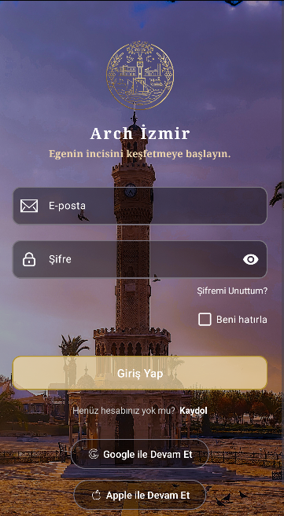
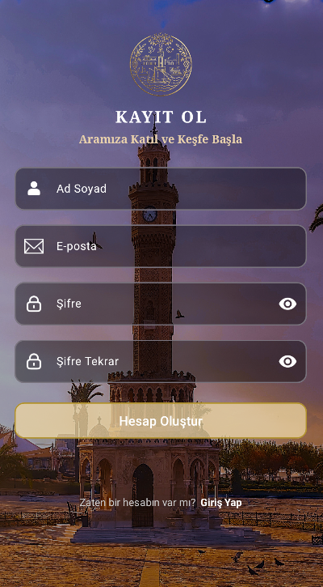
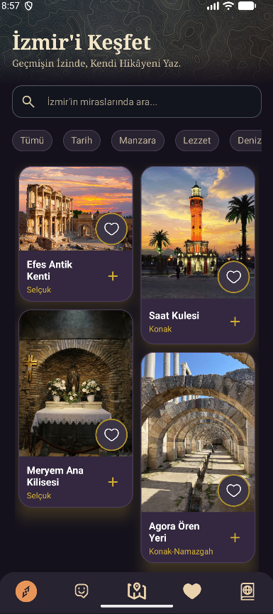

# Arch İzmir

İzmir'in tarihi yerlerini, denizlerini ve doğal güzelliklerini tanıtan bir Android uygulaması. Kadifekale'den Agora'ya, Kordon'dan Çeşme koylarına kadar şehri keşfetmek isteyenler için hazırlanıyor.

> 🚧 **Proje geliştirme aşamasındadır.** Aşağıdaki özellikler zamanla güncellenmektedir.

---

## 📱 Ekran Görüntüleri

<table align="center">
  <tr>
    <td align="center"><br/><b>Giriş</b></td>
    <td align="center"><br/><b>Kayıt</b></td>
    <td align="center"><br/><b>Ana Sayfa</b></td>
  </tr>
</table>

| Yer Detayı | Favoriler | Harita |
|:---:|:---:|:---:|
| *(yakında)* | *(yakında)* | *(yakında)* |

---

## ✨ Özellikler

### Tamamlananlar
- [x] E-posta, Ad Soyad ve şifre ile kayıt olma
- [x] E-posta ve şifre ile giriş yapma
- [x] "Beni hatırla" ile otomatik giriş
- [x] Tarihi yerlerin listelenmesi (RecyclerView-Home)
- [x] Yerel veritabanında kullanıcı bilgisi saklama

### Planlananlar
- [ ] İzmir'in deniz ve plajlarının tanıtımı
- [ ] Harita üzerinde yerleri gösterme, en yakın rota oluşturma
- [ ] Kategorilere göre filtreleme (tarihi yerler, deniz, doğa)
- [ ] Arama
- [ ] Favorilere Ekleme
- [ ] Karanlık / aydınlık tema
- [ ] Türkçe ve İngilizce dil desteği
- [ ] **Yapay zeka destekli sohbet botu**
    - [ ] Galeriden fotoğraf seçme
    - [ ] Fotoğraftaki yerin tanınması ve Türkçe açıklanması
    - [ ] Basit sorulara cevap verme
- [ ] **İzmir Pasaportu**
  - [ ] Ziyaret edilen yerlerin pasaportta kaydedilmesi
  - [ ] Her yer için rozet / damga tasarımı
  - [ ] Ziyaret edilmemiş yerlerin kilitli (gri) gösterilmesi
  - [ ] Rozet kazanınca animasyon ve bildirim
  - [ ] Kategori rozetleri (Tarihi Yerler Gezgini, Deniz Aşığı vb.)
  - [ ] İlerleme göstergesi (örn. 7 / 25 yer ziyaret edildi)

---

## 🛠 Kullanılan Teknolojiler

| Alan | Teknoloji |
|---|---|
| Dil | Kotlin |
| Arayüz | XML, Material Components, ConstraintLayout |
| Mimari | Repository deseni, ViewModel |
| Yerel veri | Room (SQLite) |
| Oturum | SharedPreferences |
| Gezinme | Jetpack Navigation Component |
| Asenkron işlemler | Kotlin Coroutines |
| Görünüm bağlama | View Binding |
| Liste | RecyclerView |

---

## 📂 Proje Yapısı

```
com.example.arch_izmir
├── data
│   ├── local          # AppDatabase, User, UserDao, SessionAdministrator
│   ├── model          # Place
│   └── repository     # UserRepository, AuthResult
└── ui
    ├── auth           # LoginFragment, RegisterFragment, RegisterViewModel
    ├── home           # HomeFragment, PlaceAdapter
    └── main           # MainActivity
```

---

## 🚀 Kurulum

1. Depoyu klonlayın:
   ```bash
   git clone https://github.com/Nisanur025/arch-izmir.git
   ```
2. Android Studio ile projeyi açın.
3. Gradle senkronizasyonunun bitmesini bekleyin.
4. Bir emülatör ya da gerçek cihaz seçip **Run** ▶️ tuşuna basın.

**Gereksinimler**
- Android Studio (güncel sürüm)
- Minimum SDK: 24
- JDK 17 veya üzeri

---

## 👩‍💻 Geliştirici

**Nisanur Türkmen**
Yaşar Üniversitesi, Bilgisayar Programcılığı

- GitHub: [@Nisanur025](https://github.com/Nisanur025)
- LinkedIn: *www.linkedin.com/in/nisanurturkmen025*


Bu proje henüz bir lisansa sahip değildir. İsterseniz MIT lisansı ekleyebilirsiniz.
