# Arch İzmir

İzmir'in tarihi yerlerini, denizlerini ve doğal güzelliklerini tanıtan bir Android uygulaması. Kadifekale'den Agora'ya, Kordon'dan Çeşme koylarına kadar şehri keşfetmek isteyenler için hazırlanıyor.

> 🚧 **Proje geliştirme aşamasındadır.** Aşağıdaki özellikler zamanla güncellenmektedir.

---

## 📱 Ekran Görüntüleri

<table align="center">
  <tr>
    <td align="center" valign="top">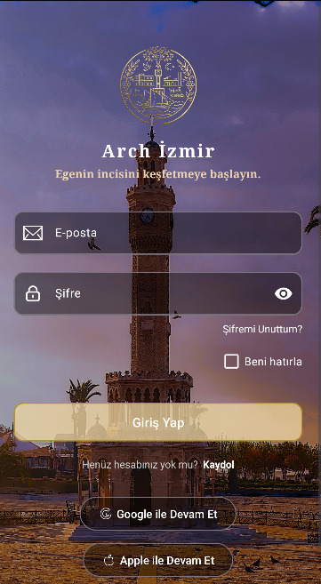<br/><b>Giriş</b></td>
    <td align="center" valign="top">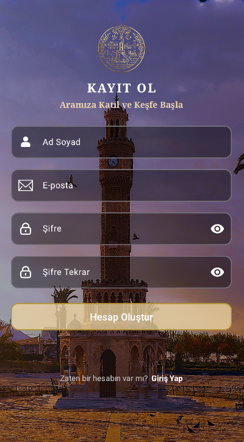<br/><b>Kayıt</b></td>
    <td align="center" valign="top">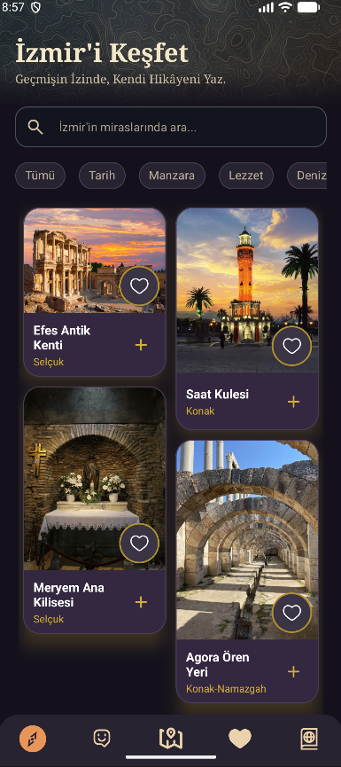<br/><b>Ana Sayfa</b></td>
  </tr>
   <tr>
    <td align="center" valign="top">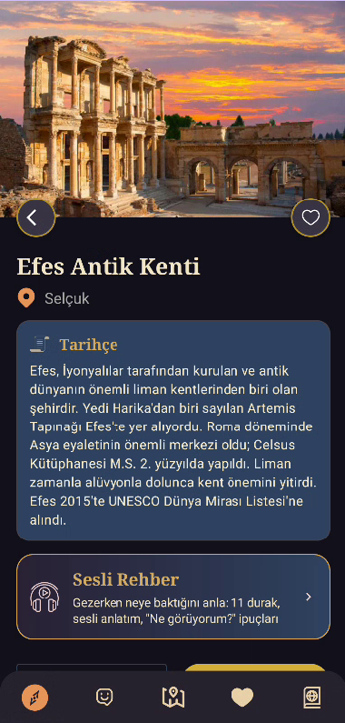<br/><b>Detay Sayfası</b></td>
    <td align="center" valign="top">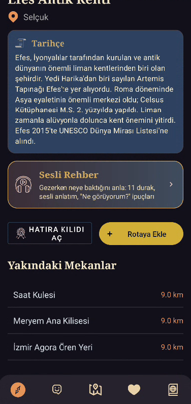<br/><b>Detay Sayfası</b></td>
    <td align="center" valign="top">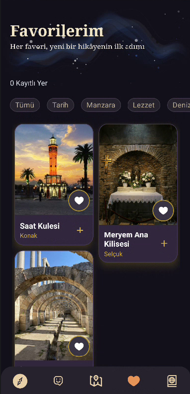<br/><b>Favori</b></td>
  </tr>
  <tr>
    <td align="center" valign="top"><br/><b>Rehber Sayfası</b></td>
    <td align="center" valign="top">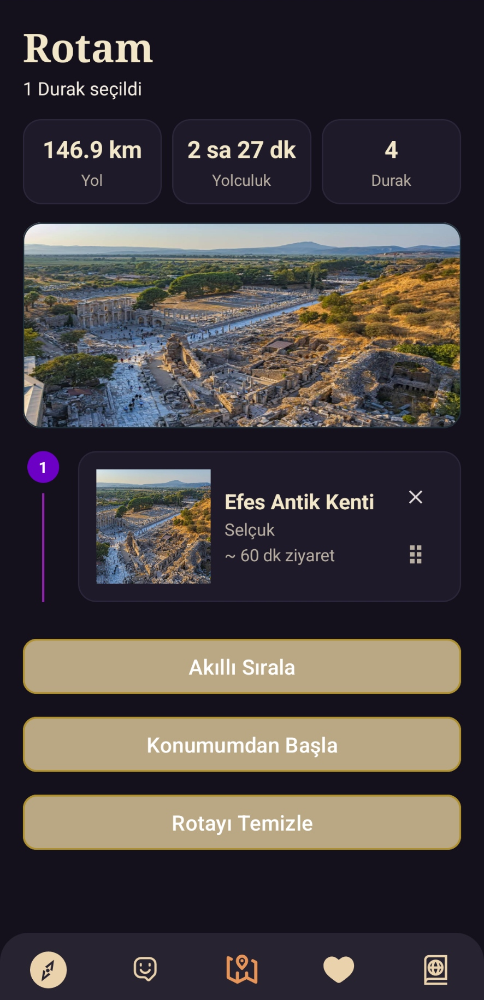<br/><b>Rota</b></td>
    <td align="center" valign="top">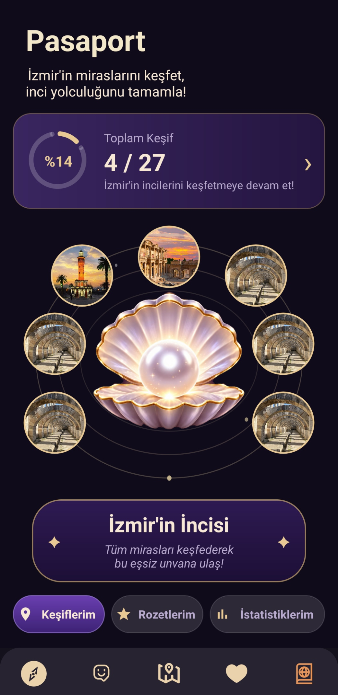<br/><b>Pasaport Sayfası</b></td>
  </tr>
  <tr>
    <td align="center" valign="top">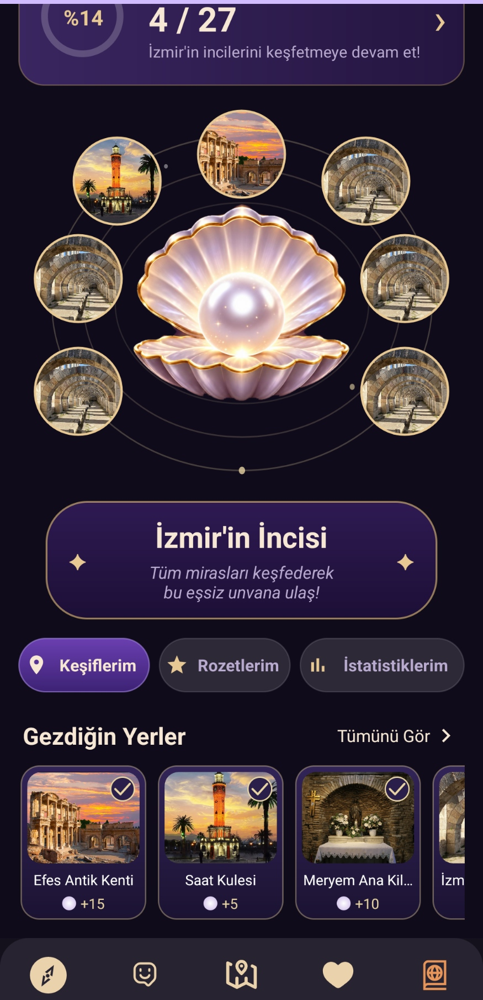<br/><b>Pasaport-Keşiflerim</b></td>
    <td align="center" valign="top">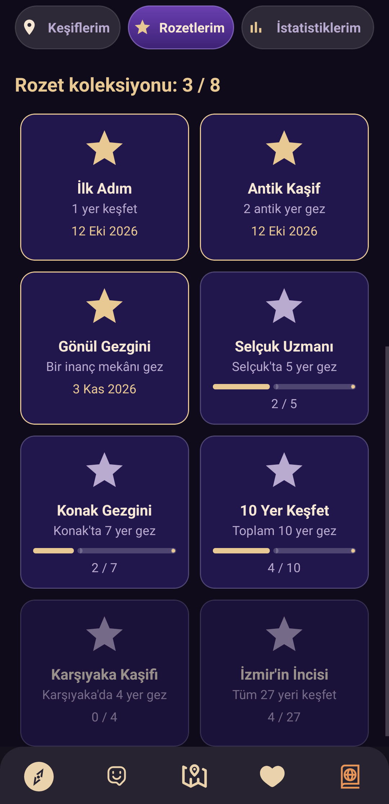<br/><b>Pasaport-Rozetlerim</b></td>
    <td align="center" valign="top">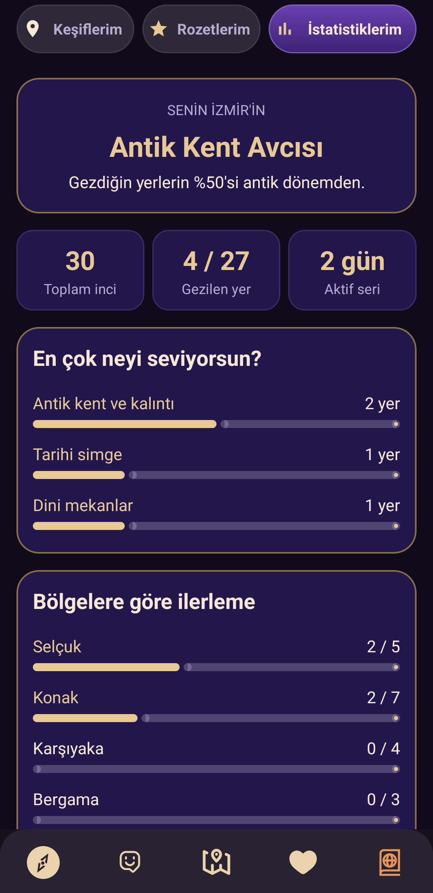<br/><b>Pasaport-İstatistikler</b></td>
  </tr>
</table>

---

## 🛠 Kullanılan Teknolojiler

| Alan | Teknoloji |
|---|---|
| Dil | Kotlin |
| Arayüz | XML, Material Components, ConstraintLayout |
| Mimari | Repository deseni, ViewModel |
| Yerel veri | Room (SQLite) |
| Oturum | SharedPreferences |
| Gezinme | Jetpack Navigation Component |
| Asenkron işlemler | Kotlin Coroutines |
| Görünüm bağlama | View Binding |
| Liste | RecyclerView |

---

## 📂 Proje Yapısı

```
com.example.arch_izmir
├── data
│   ├── local          # AppDatabase, User, UserDao, SessionAdministrator
│   ├── model          # Place
│   └── repository     # UserRepository, AuthResult
└── ui
    ├── auth           # LoginFragment, RegisterFragment, RegisterViewModel
    ├── home           # HomeFragment, PlaceAdapter
    └── main           # MainActivity
```

---

## 🚀 Kurulum

1. Depoyu klonlayın:
   ```bash
   git clone https://github.com/Nisanur025/arch-izmir.git
   ```
2. Android Studio ile projeyi açın.
3. Gradle senkronizasyonunun bitmesini bekleyin.
4. Bir emülatör ya da gerçek cihaz seçip **Run** ▶️ tuşuna basın.

**Gereksinimler**
- Android Studio (güncel sürüm)
- Minimum SDK: 24
- JDK 17 veya üzeri

---

## 👩‍💻 Geliştirici

**Nisanur Türkmen**
Yaşar Üniversitesi, Bilgisayar Programcılığı

- GitHub: [@Nisanur025](https://github.com/Nisanur025)
- LinkedIn: *www.linkedin.com/in/nisanurturkmen025*


Bu proje henüz bir lisansa sahip değildir. İsterseniz MIT lisansı ekleyebilirsiniz.
